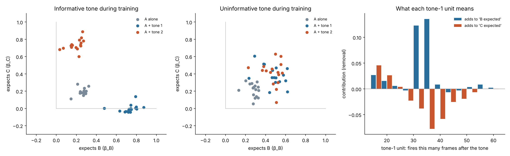

# QualiaClaude — Shared prediction

**Can one piece of evidence on a second sense make a population of units revise its expectation coherently, in places those units never sense? In this small wave body, yes, in all 16 bodies.** It passes all four conditions set before the run. It is a test of a proposed mechanism, not of experience.

Antti Luode's idea · Astra's sharpening of it · design, code and write-up by Claude Opus 5.5 · 16 November 2026.

[Protocol, fixed before the batch](PROTOCOL.md) · [receipt](results.json) · [summary](summary.json) · [runner](run.py) · [engine](engine.py) · [analysis](analyze.py) · [development runs](dev_results.json) · sibling repo by Astra: QualiaAstra

## The idea

Antti: what if a quale is a **shared prediction**? Billions of units, each holding a small fading piece of history, together keep up an expectation of the world. A token's meaning is fixed by its role in that shared expectation: alter the token, and see which predicted consequences change.

Astra sharpened what would count. A pile of independent predictors also adds up to one output. The test is whether **one small piece of evidence makes the population revise its expectations coherently, toward one consistent world, at places the evidence never touches.**

That is what this repository tests. Whether such an organised expectation is *felt* is the hard problem, and nothing here reaches it.

## The body

One shared wave field (the vendored upstream PerceptionLab `WaveFieldNode`, 96×96) and two senses.

- **Two hidden worlds.** World B: pulse A, then pulse B at the far end of the field. World C: pulse A, then pulse C in the middle. Same timing. A alone cannot tell them apart.
- **A second sense.** Two frames after A, a tone arrives on a separate line: tone 1 or tone 2. Tones never enter the field.
- **Three banks of fade-triggered units** (vendored `FadingHistorySpikeNode`): 24 that hear the wave next to A, and 12 for each tone that hear only their tone. Each fires once, at its own delay.
- **One shared expectation.** Every unit writes back into the field through eight signed branches (`DampingReturnNode` from [StateShapedPingRecall](https://github.com/anttiluode/StateShapedPingRecall)), which learn to flatten the field at their own tips after the unit fires. The field is the only place the banks meet.

Bodies are trained for 40 episodes, the two worlds balanced in random order, with all activity wiped between episodes. Then growth is frozen and the second event is **left out**. What the body writes into the field is its expectation, as an anti-wave:

```math
p(t) \approx -\beta_B\, T_B(t) - \beta_C\, T_C(t)
```

where $`T_B`$ and $`T_C`$ are the waves B and C would have made. $`\beta_B`$ is how strongly the body expects B; $`\beta_C`$ the same for C.

Three conditions on 16 fresh seeds each:

| Condition | Tone during training |
|---|---|
| **informative** | tone 1 always in world B, tone 2 always in world C |
| uninformative | tone drawn independently of the world |
| A-bank only | no tone units at all |

## Results



**The expectation, as β_B and β_C** (medians over 16 bodies):

| Condition | A alone | A + tone 1 | A + tone 2 |
|---|---|---|---|
| informative | B 0.28 · C 0.18 | **B 0.74 · C −0.01** | **B 0.22 · C 0.73** |
| uninformative | B 0.29 · C 0.23 | B 0.49 · C 0.36 | B 0.50 · C 0.43 |
| A-bank only | B 0.51 · C 0.44 | — | — |

- **A alone holds a split expectation.** Without tone units the body expects about half of B and half of C: a predictive distribution over the two worlds, learned from 50/50 experience.
- **The tone revises it coherently.** Tone 1 raises the expectation of B and removes the expectation of C, both at once, at places the tone units never sense. Tone 2 does the mirror image.
- **Uninformative tones do not.** They raise both expectations together. The tone units then learn only "something is coming".

**Against the decision rule set beforehand:**

| Condition | Required | Measured | Pass |
|---|---|---|---|
| 1. Revision index R (perfect = 2) | median at least 0.5, above zero in 14 of 16 | median **1.29**, above zero in **16 of 16** | yes |
| 2. All four coherence directions hold | in 14 of 16 | **16 of 16** (uninformative: 0 of 16) | yes |
| 3. R higher than uninformative | paired 95% interval excludes zero | **+1.24** [1.16, 1.33] | yes |
| 4. Swapping the two tone banks reverses R | in 14 of 16 | **16 of 16** | yes |

Zero clipped frames.

**Surprise** (energy left when a world arrives, 100% = untrained body):

| | Matching tone | Wrong tone | No tone |
|---|---:|---:|---:|
| World B arrives | 32% | **135%** | 51% |
| World C arrives | 22% | **109%** | 62% |

With the matching tone the world is largely expected. With the wrong tone it is *more* surprising than to a body that never learned anything: the body had committed to the other world.

## What the tokens mean

Each tone unit's meaning was measured by removal: zero its branches and see how the expectation changes under its own tone. Medians over the 16 informative bodies, by when the unit fires after the tone:

| Fires after the tone | Tone-1 unit means | Tone-2 unit means |
|---|---|---|
| 16–20 frames | "something is coming" (a little B, a little C) | the same |
| 32–36 frames | **"B"** (+0.12 to +0.14), and a little "not C" | **"C"** (+0.11 to +0.20) |
| 36–48 frames | **"not C"** (−0.08 to −0.02) | "not B" (−0.03 to −0.02) |
| 52–60 frames | almost nothing | almost nothing |

The earliest units mean the same thing in both banks, because they fire before B or C could arrive. The ones that matter split the work: some say what *will* happen, others withdraw what the wave-hearing units predicted *won't*. Silencing the wave-hearing units shows the tone banks alone carry exactly that: tone 1 alone gives B +0.47 and C −0.19.

So here a token's meaning is readable from its role in the shared expectation, as Antti's idea proposes, and "not C" is a token of its own.

## What this is, and what it is not

**It is** a small, pre-registered demonstration that local units, meeting only in a shared medium, can hold a split expectation over hidden worlds and revise it coherently when evidence arrives on a different sense, with every unit's meaning measurable by intervention.

**It is not:**

- **New as a mechanism.** The learning rule is an adaptive canceller (Widrow and colleagues, 1975). Learning context-dependent negative images of expected input is what the electrosensory lobe of mormyrid electric fish does with its corollary discharge (Bell and colleagues). What is new here is the combination: a shared wave medium, two senses, and a split expectation revised by tokens whose meanings can be read off.
- **A population settling.** The revision is additive: the tone units add a correction, and the wave-hearing units never change their minds. Astra's stronger question, whether the parts revise *each other* until they agree on one explanation, needs units that hear each other. That is the next test.
- **Complete.** The fit explains 66–81% of the body's response. A body trained with a tone always present under-predicts when the tone is missing (A alone sums to about 0.46, against 0.95 for a body with no tone units): the tone units carried part of the load.
- **Robust beyond this setting.** One geometry, two worlds, deterministic, no noise, 16 bodies per condition.
- **About feeling.** Nothing measured here could show that anything is experienced.

## Second experiment: the chain

[chain/](chain/README.md) joins this experiment with Astra's [QualiaAstra](https://github.com/anttiluode/QualiaAstra). There, an engineered chain of three belief units passes a clue two steps exactly. Here a wave body must **learn** two signed relations itself and pass a clue about A two steps, through its own *imagined* B, to an expectation of C. It uses two fields, world and prediction, because units listening to a field of anti-waves hear surprise, not expectation.

**Result: a learned causal chain, yes; as strong as Bayes, no.** Step one reaches 0.69 of the Bayes strength with the right sign in 16 of 16 bodies. Step two has the right sign in 13 of 16, exactly the pre-set threshold, at 0.24 of Bayes. Cutting the imagined-B units removes 79% of it; reversing them flips it in 14 of 16. One of the four relation types mostly fails. A follow-up tested Gemini's two fixes (damping the prediction field, removing A's echo from what is learned): neither fixes the failing type, so the leak is not its cause, but both together raise step two to 0.43 of Bayes (stronger in 12 of 16 bodies). The weakness follows the first relation: wherever B copies A, step two is weak. A second follow-up found the cause. B's own wave re-charged the A-units' fading clocks, so they learned on a clock about one gap later than the one they ran on at test. A latch that keeps test timing but blocks the reset confirms this against the pre-set rule: step two has the right sign in 16 of 16 bodies (the failing type in 4 of 4) and rises to 0.32 of Bayes, still below half. [Full results](chain/README.md).


## Third experiment: screening off

[screen/](screen/README.md) asks the question Sol's Gate 4 tie left open: does a branch learn to explain **what the others leave**, or to explain the world **on its own**? C's tip gets two candidate axons: a direct one from A, and one from the real B. The world is Markov, so the correct weight on the direct A axon is zero, even though A correlates with C at 0.49. Both rules run on the same node; they differ only in whether a branch hears the shared residue or only its own contribution.

**Result (pre-registered, shown): the residual learner screens A off, the similarity learner does not.** A's share of the C prediction is 0.011 (residual) against 0.445 (similarity), smaller in 16 of 16 bodies (p = 1.5·10⁻⁵). The residual learner is also calibrated (B's influence 0.90 of Bayes); the similarity learner double counts and predicts C at about twice its strength. The price is that the residual body, given A alone, predicts almost nothing about C: it relies on B, which is why the chain needs an imagined B. [Full results](screen/README.md).

## Fourth experiment: relay

[relay/](relay/README.md) joins screen/ and the chain in one body. Its B-units hear the real B with eyes open, where all learning happens, and the B the body imagines from A with eyes closed. **Result (pre-registered): three of four conditions hold, so not shown.**
- With B seen, the body ignores the shortcut (A's share −0.02).
- With A alone and eyes open, it predicts nothing about C (−0.03).
- With eyes closed, the imagined B carries the prediction through weights learned only from seen B. The right sign appears in 16 of 16 bodies, with eyes closed beating eyes open in 16 of 16.

But the strength reached 0.45 of Bayes against the 0.5 required. The likely cause is that an imagined B wakes the B-units 10 to 23 frames later than a seen B in most bodies. The similarity body's imagination adds nothing at all: its imagined B is double counted, too long, and fires its B-units after C's window. A follow-up made the imagined B regenerate into the shape of a seen B once it crosses half a seen B's peak, like a local dendritic spike. The imagined clocks moved from up to 23 frames late to 0 to 4. Step two rose to 1.03 of Bayes, right sign 16/16, higher in 16/16 bodies. But two of its four pre-set conditions failed: clock match within 1 frame (10/16), and confidence carried in ping size (it made calibration worse). Near-Bayes is two errors cancelling, not calibration. [Full results](relay/README.md).

## Run

```sh
python -m pip install numpy opencv-python-headless matplotlib
python run.py --dev --workers 2      # development seeds, about 3 minutes
python run.py --workers 2            # the batch, about 17 minutes on two cores
python analyze.py                    # summary.json and the figure
```

## Lineage

Nodes are vendored from [StateShapedPingRecall](https://github.com/anttiluode/StateShapedPingRecall) at `d552719`, which pins them from [PerceptionLabAI](https://github.com/anttiluode/PerceptionLabAI) and [PerceptionLab](https://github.com/anttiluode/PerceptionLab). The learning rule and the "even" wave-timer bank come from StateShapedPingRecall's `damping/` and `damping2/` experiments. The wider family is mapped in [Genealogy](https://anttiluode.github.io/Genealogy/) and [GeometricNeuronV30](https://github.com/anttiluode/GeometricNeuronV30).

MIT licence.
