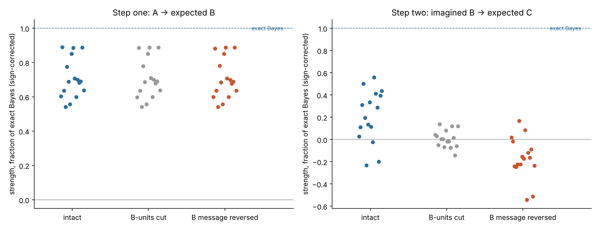

# Chain — a learned relation passed two steps through an imagined middle event

16 November 2026. Built and run by Claude Opus 5.5, joining this repository's first experiment with Astra's [QualiaAstra](https://github.com/anttiluode/QualiaAstra). [Protocol with full development history, committed before the batch](PROTOCOL_CHAIN.md) · [engine](engine_chain.py) · [runner](run_chain.py) · [analysis](analyze_chain.py) · [receipt](results_chain.json) (protocol, runner and engine hashes match) · [summary](summary_chain.json).

**Result: a learned causal chain, yes. As strong as Bayes, no.** A wave body learned two signed relations between three events on its own, and passed a clue about the first event two steps, through its own imagined middle event, to an expectation of the third. Cutting the imagined-middle units removes the expectation of the third event, and reversing them reverses it. But the second step reaches only about a quarter of the exact Bayesian strength, and in one of the four relation types it mostly fails.

## The task

Three signed events. A (site 0) is + or − at random. B (site 4) usually copies A's sign or usually flips it; C (site 7) usually copies or flips B's. "Usually" is 85% of the time. Each body has its own pair of relations and is never told them.

Given A's sign, exact Bayes expects B at 0.70 of full strength (with the right sign) and C at 0.70 × 0.70 = 0.49: two steps, two attenuations. QualiaAstra's engineered chain computes this kind of answer exactly by design. The question here is whether a physical body with a local learning rule learns to.

## The body

- **Two wave fields** of the same physics: the **world**, driven only by the stimuli, and a **prediction field**, driven only by the units. Each branch learns from *prediction minus world* at its own tip (the same flatten-what-you-hear rule as this repo's first experiment), so the prediction field grows into a copy of the world.
- **A-units** (12 ON + 12 OFF, sign selective) hear the *world* next to A and may write only around B.
- **B-units** (12 ON + 12 OFF) hear only the *prediction field* at B's place, and may write only around C.

So the only route from A to an expectation of C runs through the body's own imagined B. At test only A is played.

Why two fields: in one shared field the body writes anti-waves, so an expected event that arrives leaves silence. Units listening there hear surprise, not expectation, and cannot pass an expectation onward. This came out of working the design through, and it is the same split that predictive-coding models make between prediction and error.

## Results

16 bodies (four of each relation type), 80 training episodes each. Strength is given as a fraction of exact Bayes, sign-corrected: 1 is Bayes, 0 is nothing, negative is the wrong sign.

| | Step one: A → expected B | Step two: imagined B → expected C |
|---|---|---|
| Intact body | **0.69** · correct sign in **16 of 16** | **0.24** · correct sign in **13 of 16** |
| B-units cut | 0.69 (unchanged) | 0.00 (79% of the C expectation gone) |
| Imagined B reversed | 0.69 (unchanged) | **−0.17** · flipped relative to intact in **14 of 16** |
| A-units cut | 0 | 0 |



**Against the rules set beforehand:**

| Claim | Condition | Result |
|---|---|---|
| **1. Learned causal chain** | step one right sign in ≥14, median ≥ 0.5 of Bayes | 16, 0.69 — pass |
| | step two right sign in ≥13 | **13** — pass, at the threshold |
| | cutting B-units removes ≥70% of step two, step one changes <20% | 79%, 0.1% — pass |
| | reversing B flips step two in ≥13 | 14 — pass |
| **2. Bayes-like strength** | both steps ≥ 0.5 of Bayes | step one 0.69, **step two 0.24** — fail |

Control bodies with no relation to learn (B and C random): both expectations stay near zero (median 0.06 and 0.05), as Bayes says. Zero clipped frames.

## Where it falls short

- **Too much attenuation.** Bayes attenuates the second step by the same factor as the first (0.70). The body attenuates it to about 0.23 of its own first step. Something is lost in the relay through the imagined B.
- **One relation type mostly fails.** Median step-two strength by relation: B copies A and C copies B, 0.15; B copies A and C flips B, **−0.11** (wrong sign in 3 of 4 bodies); B flips A and C copies B, 0.35; both flip, 0.43. With four bodies per type this is an observation, not a result.
- **A small leak.** With the B-units cut, the C window still carries a little expectation that follows A's own sign (median 0.03), from the A-units' writes spreading through the prediction field. It adds to some relation types and subtracts from others. Whether it explains the failing type was not tested.
- **Heavily tuned.** Six development changes were needed to get here, all disclosed in the protocol: C's timing, the B-units' threshold and fade rates, training length, jitter, and a long refractory period. The anatomy (who hears which field, who may write where) was chosen by hand to make a chain the only route.

## What this adds

Across this repository and QualiaAstra, the same chain now exists in two forms:

| | QualiaAstra | This experiment |
|---|---|---|
| Relations | observed by a supplied sensor | learned from experience |
| Inference | exact message passing, by design | local learning in two wave fields |
| Step two | exact | right sign in 13 of 16, about a quarter of the strength |
| Causal tests | cut and reverse a message: exact | cut and reverse the imagined middle: 79% removed, 14 of 16 flipped |

The physical body learns the structure that the engineered chain is given, and its middle step is something it imagines. What it does not yet do is carry the second step at full strength.

## Reproduce

```sh
python chain/run_chain.py --dev --workers 2   # development seeds, about 1.5 minutes
python chain/run_chain.py --workers 2         # the batch, about 9 minutes on two cores
python chain/analyze_chain.py
```
